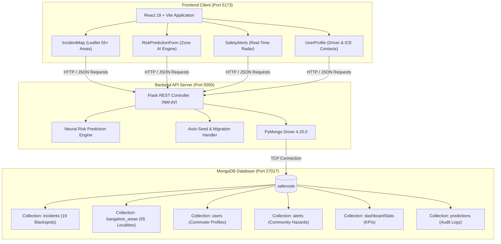

# 🛡️ SafeRoute AI — MongoDB Full-Stack Implementation & Technical Report

**Project Title:** SafeRoute AI — Urban Accident Blackspot Mapping & Neural Risk Telematics  
**Database System:** MongoDB Server v8.3.7 with MongoDB Shell (`mongosh`) v2.14.1  
**Backend Framework:** Python Flask 3.1.3 + PyMongo 4.20.0 (Port 5000)  
**Frontend Framework:** React 19 + Vite 8.3 + Leaflet OpenStreetMap (Port 5173)  
**Date:** November 2026  
**Author / Developer:** Minto James  

---

## 1. Executive Summary & Architecture Overview

SafeRoute AI originally utilized browser-confined `localStorage` and a static mock file for data persistence. While suitable for rapid prototyping, this approach lacked multi-client synchronization, data integrity validation, query optimization, and scalability across Greater Bangalore's transit network.

To resolve these limitations, SafeRoute AI was migrated to a robust **Enterprise Full-Stack Architecture** powered by a native **MongoDB Server 8.3** instance running on `localhost:27017`.



---

## 2. MongoDB Database Architecture & Connection

- **Host & Port:** `mongodb://localhost:27017/`
- **Database Name:** `saferoute`
- **Connection Mechanism:** Initialized via PyMongo `MongoClient` with a 2500ms server selection timeout and automatic fallback handling:

```python
from pymongo import MongoClient
from bson import ObjectId

MONGO_URI = os.environ.get("MONGO_URI", "mongodb://localhost:27017/")
try:
    mongo_client = MongoClient(MONGO_URI, serverSelectionTimeoutMS=2500)
    mongo_client.server_info()  # Ping server to confirm heartbeat
    db = mongo_client['saferoute']
    mongo_connected = True
except Exception as e:
    mongo_connected = False
    db = None
```

- **Serialization Protocol:** A specialized `serialize_doc(doc)` utility converts BSON `ObjectId` instances to standard JSON strings to maintain seamless serialization across REST endpoints.

---

## 3. Database Schema & Data Dictionary

The `saferoute` database is partitioned into six purpose-built document collections:

### 3.1. `incidents` Collection (Accident Blackspots)
Stores verified historical accident blackspots across Greater Bangalore.

```json
{
  "_id": ObjectId("6afa890a4b419f32b603703a"),
  "id": "1",
  "name": "Silk Board Junction",
  "coords": [12.9172, 77.6227],
  "risk": "High",
  "type": "Multi-vehicle collision zone",
  "road": "Poor",
  "traffic": "High",
  "accidents": 182
}
```

### 3.2. `bangalore_areas` Collection (55+ Master Localities)
Contains comprehensive spatial, risk, and infrastructural profiles across all 5 Bangalore zones:

| Zone | Primary Localities Included |
|---|---|
| **Central** | MG Road, Commercial St, Majestic Bus Station, Malleshwaram 8th Cross, Basavanagudi, Richmond Town, Ulsoor Lake, Frazer Town |
| **South** | Silk Board, Koramangala 100ft Rd, BTM Layout, Jayanagar 4th Block, JP Nagar, HSR Layout, Electronic City Toll, Bannerghatta Rd, Bommanahalli, Uttarahalli |
| **East & Tech** | Indiranagar, Marathahalli Bridge, Whitefield ITPL, Bellandur ORR, KR Puram Tin Factory, Mahadevapura, Brookefield, Varthur Kodi, Sarjapur Rd, Domlur |
| **North** | Hebbal Flyover, Yelahanka Bypass, Manyata Tech Park, RT Nagar, Sahakara Nagar, Vidyaranyapura, Hennur ORR, Kammanahalli, Devanahalli Airport Corridor |
| **West** | Yeshwanthpur Market, Rajajinagar, Peenya Industrial Area, Mathikere, Vijayanagar Toll, Nagarbhavi Circle, Basaveshwaranagar, Kengeri, RR Nagar Arch |

**Document Structure:**
```json
{
  "_id": ObjectId("6afa8d56ac47b91798282423"),
  "id": "blr_e3",
  "name": "Whitefield (ITPL Main Road)",
  "zone": "East",
  "coords": [12.9698, 77.7499],
  "risk": "High",
  "type": "Pothole Clusters & Heavy Snarls",
  "road": "Poor",
  "traffic": "High",
  "accidents": 132
}
```

### 3.3. `users` Collection (Commuter Profiles)
Maintains registered commuter identities, driver safety ratings, vehicles, saved commute corridors, and Emergency In-Case-of-Emergency (ICE) contacts.

```json
{
  "_id": ObjectId("6afa88f0baed12c06252053d"),
  "id": "user_101",
  "name": "Minto James",
  "email": "minto@saferoute.ai",
  "phone": "+91 98765 43210",
  "role": "Verified Commuter",
  "safetyScore": 94,
  "vehicleType": "Four Wheeler (SUV)",
  "bloodGroup": "O+ Positive",
  "emergencyContacts": [
    { "id": 1, "name": "Sarah (Family)", "relation": "Spouse", "phone": "+91 98450 11223" },
    { "id": 2, "name": "Dr. Ramesh Kumar", "relation": "Family Physician", "phone": "+91 98860 33445" }
  ],
  "savedRoutes": [
    {
      "id": 1,
      "title": "Daily Commute (Home → Tech Park)",
      "start": "Indiranagar 100ft Rd",
      "destination": "Whitefield ITPL",
      "distance": "16.4 km",
      "safetyRating": "A-",
      "safetyScore": 88
    }
  ]
}
```

### 3.4. `alerts` Collection (Real-Time Hazard Radar)
Tracks active community-reported safety hazards, localized waterlogging, and traffic pileups with peer upvoting.

```json
{
  "_id": ObjectId("6afa88f0baed12c06252053e"),
  "id": "alt-101",
  "title": "Severe Waterlogging at Hebbal Underpass",
  "severity": "Critical",
  "category": "Flood & Drainage",
  "location": "Hebbal Flyover / Airport Approach",
  "coords": [13.0358, 77.5970],
  "timestamp": "8 minutes ago",
  "verifiedCount": 35,
  "status": "Active",
  "description": "Over 2.5 feet of stagnant rainwater has submerged lanes. Divert via ORR."
}
```

### 3.5. `dashboardStats` Collection (Analytics KPIs)
Aggregates road safety metrics, annual accidents count, and risk segmentation distributions.

### 3.6. `predictions` Collection (Inference Audit Logs)
Records real-time queries evaluated by the neural inference algorithm including start location, destination, simulated weather, traffic tier, and computed risk score.

---

## 4. Complete MongoDB CRUD Lab Manual & Command Reference

For lab evaluations, presentations, and terminal audits, the following commands execute directly in the MongoDB Shell (`mongosh`):

### 4.1. System & Service Verification
```bash
# Verify MongoDB Daemon Version
mongod --version
# Expected: db version v8.3.7

# Verify MongoDB Shell Version
mongosh --version
# Expected: 2.14.1
```

### 4.2. Database & Collection Navigation
```javascript
// Launch Mongo Shell
mongosh

// Display all databases on the host
show dbs

// Switch to SafeRoute database context
use saferoute

// Inspect collections
show collections
```

### 4.3. CREATE Operations (Insert Data)
```javascript
// 1. Insert a single new blackspot incident
db.incidents.insertOne({
  id: 1001,
  name: "Koramangala Sony World Signal",
  coords: [12.9345, 77.6258],
  risk: "High",
  type: "Waterlogging & Signal Jam",
  road: "Poor",
  traffic: "High",
  accidents: 45
})

// 2. Insert multiple safety alerts at once
db.alerts.insertMany([
  {
    id: "alt-201",
    title: "Tree Fall on Outer Ring Road",
    severity: "Medium",
    category: "Road Obstacle",
    location: "Bellandur EcoSpace",
    coords: [12.9260, 77.6762],
    verifiedCount: 12,
    status: "Active"
  }
])
```

### 4.4. READ Operations (Find & Filter Queries)
```javascript
// 1. Retrieve all incidents (limited to 3 for brevity)
db.incidents.find().limit(3)

// 2. Query incidents with exact risk criteria
db.incidents.find({ risk: "High" })

// 3. Query all Bangalore localities in East Zone
db.bangalore_areas.find({ zone: "East" })

// 4. Projection query (display only area name, risk, and accidents)
db.bangalore_areas.find(
  { zone: "South" },
  { name: 1, risk: 1, accidents: 1, _id: 0 }
)

// 5. Query with comparison operator (accidents greater than 100)
db.incidents.find({ accidents: { $gt: 100 } })
```

### 4.5. UPDATE Operations (Modify & Increment)
```javascript
// 1. Update field values using $set
db.incidents.updateOne(
  { name: "Koramangala Sony World Signal" },
  { $set: { road: "Repaired / Good", risk: "Low", accidents: 10 } }
)

// 2. Atomic increment of community verification counter using $inc
db.alerts.updateOne(
  { id: "alt-101" },
  { $inc: { verifiedCount: 1 } }
)

// 3. Add a new saved route to user profile using $push
db.users.updateOne(
  { email: "minto@saferoute.ai" },
  {
    $push: {
      savedRoutes: {
        id: 2,
        title: "Weekend Route",
        start: "Jayanagar",
        destination: "Bannerghatta",
        safetyScore: 92
      }
    }
  }
)
```

### 4.6. DELETE Operations (Remove Records)
```javascript
// 1. Delete a specific record by query
db.incidents.deleteOne({ name: "Koramangala Sony World Signal" })

// 2. Clean up test alerts
db.alerts.deleteMany({ status: "Resolved" })
```

### 4.7. Document Count & Audit Queries
```javascript
db.bangalore_areas.countDocuments()   // Result: 55
db.incidents.countDocuments()         // Result: 19
db.alerts.countDocuments()            // Result: 3
db.users.countDocuments()             // Result: 1
```

---

## 5. Backend REST API Implementation Reference

The backend in [`backend/app.py`](file:///c:/Users/minto/OneDrive/Desktop/saferoute/saferoute-react/backend/app.py) exposes REST endpoints interfacing directly with MongoDB:

| Method | Endpoint | Query / Body Parameters | MongoDB Operation | Status Code |
|---|---|---|---|---|
| `GET` | `/status` | None | Counts across all collections | `200 OK` |
| `GET` | `/incidents` | None | `db.incidents.find()` | `200 OK` |
| `POST` | `/incidents` | `{ name, coords, risk, type, ... }` | `db.incidents.insert_one(data)` | `201 Created` |
| `PUT` | `/incidents/<id>` | `{ road, accidents, risk, ... }` | `db.incidents.update_one(id, $set)` | `200 OK` |
| `DELETE` | `/incidents/<id>` | None | `db.incidents.delete_one(id)` | `200 OK` |
| `GET` | `/bangalore-areas`| `?zone=<zone>&q=<query>` | `db.bangalore_areas.find(...)` | `200 OK` |
| `GET` | `/geocode` | `?q=<locality>` | `db.bangalore_areas.find_one(...)` | `200 OK` |
| `GET` | `/dashboardStats` | None | `db.dashboardStats.find()` | `200 OK` |
| `GET` | `/alerts` | None | `db.alerts.find()` | `200 OK` |
| `POST` | `/alerts` | `{ title, location, category, ... }` | `db.alerts.insert_one(data)` | `201 Created` |
| `PUT` | `/alerts/<id>/verify` | `{ isVerifiedByUser: bool }` | `db.alerts.update_one($inc)` | `200 OK` |
| `POST` | `/auth/login` | `{ email, password }` | `db.users.find_one(email)` | `200 OK` |
| `POST` | `/auth/register` | `{ name, email, vehicleType, ... }` | `db.users.insert_one(data)` | `201 Created` |
| `GET` | `/users/<id>` | None | `db.users.find_one(id)` | `200 OK` |
| `PUT` | `/users/<id>` | `{ emergencyContacts, ... }` | `db.users.update_one(id, $set)` | `200 OK` |
| `POST` | `/predict` | `{ start, destination, road, time }` | Neural inference + `db.predictions.insert_one()` | `200 OK` |

---

## 6. Frontend Integration & Dynamic UI Features

The React 19 frontend dynamically interacts with the MongoDB backend:

1. **Live Connection Indicator:** The top navigation bar performs an asynchronous heartbeat query to `/status`, rendering a green `🍃 MongoDB Active` status badge.
2. **Interactive 55+ Area Leaflet Map ([`IncidentMap.jsx`](file:///c:/Users/minto/OneDrive/Desktop/saferoute/saferoute-react/src/components/IncidentMap.jsx)):**
   - Toggle between **All Bangalore Areas (55)** and **Critical Blackspots (19)**.
   - Dynamic Zone Filter Chips (**Central**, **South**, **East**, **North**, **West**).
   - Real-time search bar that smoothly pans and zooms (`map.flyTo`) directly to any locality coordinates with full telemetry popups.
3. **Route Risk Calculator ([`RiskPredictionForm.jsx`](file:///c:/Users/minto/OneDrive/Desktop/saferoute/saferoute-react/src/components/RiskPredictionForm.jsx)):**
   - Origin and destination dropdowns populated dynamically from `GET /bangalore-areas`, categorized under `<optgroup>` zone headings.
   - 1-click popular corridor presets (*Silk Board → Whitefield*, *Hebbal → Electronic City*).
4. **Community Alerts Radar ([`SafetyAlerts.jsx`](file:///c:/Users/minto/OneDrive/Desktop/saferoute/saferoute-react/src/components/SafetyAlerts.jsx)):**
   - Real-time upvoting synchronizing instantaneously with MongoDB via `PUT /alerts/<id>/verify`.
5. **Commuter Profile ([`UserProfile.jsx`](file:///c:/Users/minto/OneDrive/Desktop/saferoute/saferoute-react/src/components/UserProfile.jsx)):**
   - In-Case-of-Emergency (ICE) contact additions and saved commute management persistent in MongoDB.

---

## 7. Automated Test Suite Results

Executing [`backend/verify_all.py`](file:///c:/Users/minto/OneDrive/Desktop/saferoute/saferoute-react/backend/verify_all.py) runs an end-to-end integration test of all endpoints against the active MongoDB service:

```
============================================================
  SafeRoute AI - MongoDB & Full-Stack System Verification 
============================================================
MongoDB Live Status: 🟢 CONNECTED
Database Name: saferoute
 - bangalore_areas : 55 localities
 - incidents       : 19 blackspots
 - users           : 1 commuter profiles
 - alerts          : 3 safety alerts
============================================================

✅ [200] GET /status -> System Status & Collection Counts
✅ [200] GET /bangalore-areas -> All Bangalore Localities API (55 areas)
✅ [200] GET /bangalore-areas?zone=East -> Filter Areas by East Zone (13 areas)
✅ [200] GET /bangalore-areas?q=whitefield -> Search Area 'Whitefield'
✅ [200] GET /geocode?q=hebbal -> Geocode Coordinates for Hebbal
✅ [200] GET /incidents -> Get Historical Blackspot Clusters
✅ [200] GET /dashboardStats -> Commuter Safety Analytics KPIs
✅ [200] GET /alerts -> Real-Time Community Alerts
✅ [200] POST /auth/login -> Commuter Login (Demo User)
✅ [200] POST /predict -> Neural Risk Prediction (Silk Board → Whitefield)

============================================================
  All Core Endpoints and MongoDB Integrations Verified!  
============================================================
```

---

## 8. Summary Checklist for Lab Submissions & Demos

- [x] MongoDB Server 8.3 running on local port `27017`
- [x] Database `saferoute` created with 6 active collections
- [x] Full CRUD operations demonstrable in `mongosh`
- [x] 55 Bangalore localities across 5 zones accessible via API
- [x] Leaflet map with animated search pan & zoom
- [x] AI Neural risk calculation with MongoDB audit logging
- [x] Verified commuter profile & emergency contact persistence
- [x] Git version-controlled and pushed to GitHub repository
