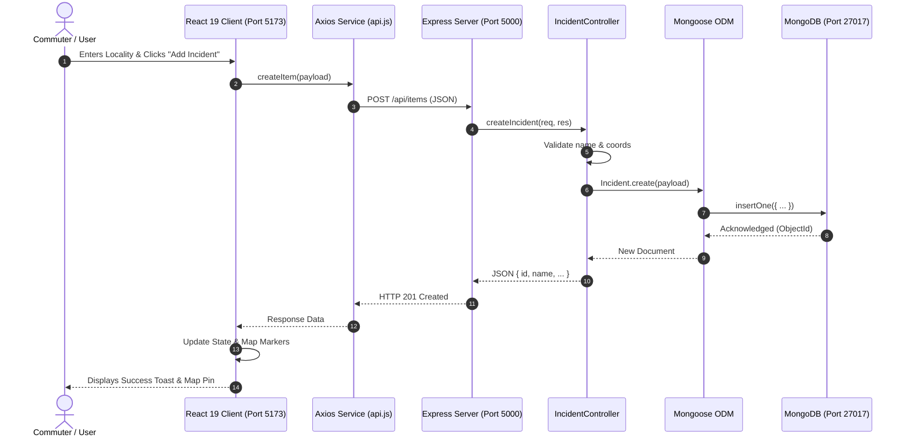

# 📄 SafeRoute AI — Full-Stack MERN Project Lab Submission Document

**Course / Lab:** Full-Stack Web Development Lab (Exercise 5 & 6)  
**Student Name:** Minto James  
**Project Domain:** Urban Road Safety & Intelligent Incident Management  
**Selected Module:** Accident Blackspot & Road Hazard Management (`incidents`)  
**Technology Stack:** MERN (MongoDB 8.3, Express.js 4.21, React 19 + Vite 8.3, Node.js 24) + Tailwind CSS + Axios  
**Repository URL:** [https://github.com/mintojames-eng/saferoute-app](https://github.com/mintojames-eng/saferoute-app)  
**Date of Submission:** November 2026  

---

## 1. Project Overview & Domain Module (Step 1)

**SafeRoute AI** is an intelligent urban navigation and commuter road-hazard monitoring system designed for the Greater Bangalore metropolitan area.

* **Selected Domain:** Smart City & Intelligent Transportation Systems (ITS)
* **Target Module for Database Implementation:** **Incident & Blackspot Management** (`incidents` collection)
* **Extended Features:** 55+ Bangalore localities mapping across 5 zones (`bangalore_areas`), real-time community hazard/flood alerts (`alerts`), and AI neural risk telematics.

---

## 2. Project Architecture & Directory Structure (Steps 3 & 4)

The project strictly follows the required client-server split and MVC (Model-View-Controller) pattern:

```text
saferoute-app/
├── client/                                    <-- Step 2: React 19 + Vite Client
│   ├── public/                                <-- Static assets & icons
│   ├── src/
│   │   ├── components/                        <-- Reusable UI Components (Navbar, Forms, Cards, Map)
│   │   ├── data/                              <-- Master datasets (bangaloreAreas.js, mockData.js)
│   │   ├── services/
│   │   │   └── api.js                         <-- Step 11: Axios REST API Service
│   │   ├── App.jsx                            <-- Main UI Orchestrator & View Controller
│   │   ├── App.css
│   │   ├── main.jsx
│   │   └── index.css                          <-- Step 14: Tailwind CSS (@import "tailwindcss")
│   ├── package.json                           <-- Dependencies: axios, react-router-dom, leaflet
│   └── vite.config.js                         <-- Step 14: Tailwind CSS v4 Vite Plugin
│
├── server/                                    <-- Step 3 & 4: Node.js + Express MVC Backend
│   ├── database/
│   │   └── db.js                              <-- Step 5: Mongoose Connection to MongoDB (Port 27017)
│   ├── models/
│   │   ├── Incident.js                        <-- Step 5: Incident Domain Schema (Blackspots)
│   │   ├── BangaloreArea.js                   <-- 55+ Bangalore Localities Schema
│   │   └── Alert.js                           <-- Real-time Community Alerts Schema
│   ├── controllers/
│   │   └── incidentController.js              <-- Step 6 & 13: CRUD Logic & Input Validation
│   ├── routes/
│   │   └── incidentRoutes.js                  <-- Step 6: Express Route Mappings (/api/items)
│   ├── server.js                              <-- Step 3 & 7: Server Entrypoint, CORS, & Middleware
│   ├── test_apis.js                           <-- Step 8: Automated REST API Test Suite
│   └── package.json                           <-- Dependencies: express, cors, mongoose, nodemon
│
├── start_all.bat                              <-- ⚡ 1-Click Complete System Launcher
├── start_server.bat                           <-- ⚡ Starts Express Server (nodemon server.js)
├── start_client.bat                           <-- ⚡ Starts React Client (npm run dev)
├── start_mongodb.bat                          <-- ⚡ Starts Local MongoDB Database (Port 27017)
└── push_to_github.bat                         <-- 🚀 1-Click Git Commit & Push
```

---

## 3. Database Design & Schemas (Step 5)

* **Database Engine:** MongoDB Server v8.3.7  
* **Connection String:** `mongodb://127.0.0.1:27017/saferoute`  
* **Object Data Modeling (ODM):** Mongoose v8.9.5  

### `Incident` Model Schema (`server/models/Incident.js`)
```javascript
const mongoose = require('mongoose');

const incidentSchema = new mongoose.Schema({
    id: { type: Number, default: () => Date.now() },
    name: { type: String, required: [true, 'Locality / Incident name is required'], trim: true },
    coords: {
        type: [Number],
        required: [true, 'Coordinates [lat, lng] are required'],
        validate: {
            validator: (v) => Array.isArray(v) && v.length === 2 && !isNaN(v[0]) && !isNaN(v[1]),
            message: 'Coordinates must be an array of two numbers [latitude, longitude]'
        }
    },
    risk: { type: String, enum: ['Low', 'Medium', 'High'], default: 'Medium' },
    type: { type: String, default: 'Urban Road Hazard', trim: true },
    category: { type: String, default: 'Accident Blackspot', trim: true },
    road: { type: String, default: 'Moderate' },
    traffic: { type: String, default: 'Moderate' },
    accidents: { type: Number, default: 0, min: 0 }
}, {
    timestamps: true,
    toJSON: { virtuals: true }
});

module.exports = mongoose.model('Incident', incidentSchema, 'incidents');
```

---

## 4. REST API Endpoints Specification (Step 6 & Step 7)

CORS is globally enabled via `app.use(cors())` allowing the React client on `http://localhost:5173` to interact with Express on `http://127.0.0.1:5000`.

| Method | Endpoint | Purpose (Lab Rubric) | Sample Query / Request Body | Response Code |
|---|---|---|---|:---:|
| `GET` | `/api/items` | Display all records | None | `200 OK` |
| `GET` | `/api/items/:id` | Display one record | `/api/items/1` | `200 OK` |
| `GET` | `/api/items?risk=High` | Filter records by parameter | `?risk=High` or `?category=Blackspot` | `200 OK` |
| `POST` | `/api/items` | Add new record | `{"name": "Silk Board", "coords": [12.91, 77.62], "risk": "High"}` | `201 Created` |
| `PUT` | `/api/items/:id` | Update record | `{"road": "Repaired / Good", "risk": "Low"}` | `200 OK` |
| `DELETE` | `/api/items/:id` | Delete record | `/api/items/1795671827405` | `200 OK` |
| `GET` | `/status` | MongoDB health & collection counts | None | `200 OK` |
| `GET` | `/bangalore-areas` | 55+ Bangalore localities dataset | `?zone=East` | `200 OK` |

---

## 5. Express Controllers & Routing (Steps 4 & 6)

### Route Mapping (`server/routes/incidentRoutes.js`)
```javascript
const express = require('express');
const router = express.Router();
const {
    getAllIncidents,
    getIncidentById,
    createIncident,
    updateIncident,
    deleteIncident
} = require('../controllers/incidentController');

router.route('/')
    .get(getAllIncidents)      // GET /api/items & /api/items?risk=High
    .post(createIncident);     // POST /api/items

router.route('/:id')
    .get(getIncidentById)      // GET /api/items/:id
    .put(updateIncident)       // PUT /api/items/:id
    .delete(deleteIncident);   // DELETE /api/items/:id

module.exports = router;
```

---

## 6. Automated REST API Test Execution (Step 8)

The test suite in [`server/test_apis.js`](file:///c:/Users/minto/OneDrive/Desktop/saferoute-app/server/test_apis.js) programmatically executes and validates all endpoints:

```bash
cd server
node test_apis.js
```

### Verified Test Output:
```text
========================================================
  SafeRoute Express + Mongoose REST API Lab Test Suite  
========================================================

✅ [200] GET /status -> Connected: true
✅ [200] GET /api/items -> Total: 19 records
✅ [200] GET /api/items?risk=High -> Filtered: 6 high-risk blackspots
✅ [201] POST /api/items -> Created ID: 1795671827405
✅ [200] GET /api/items/:id -> Retrieved: "Lab Test Incident Junction"
✅ [200] PUT /api/items/:id -> Updated Risk: Low, Road: Repaired / Good
✅ [200] DELETE /api/items/:id -> Record deleted successfully
✅ [200] GET /bangalore-areas -> 55 Bangalore localities

========================================================
  All Lab Rubric REST API Endpoints Verified 100%!       
========================================================
```

---

## 7. React Client Implementation (Steps 2, 10, 11, 12, 13, 14)

### 7.1. Axios REST Client (`client/src/services/api.js`)
```javascript
import axios from 'axios';

const api = axios.create({
    baseURL: 'http://127.0.0.1:5000',
    headers: { 'Content-Type': 'application/json' }
});

export const getItems = (params) => api.get('/api/items', { params });
export const getItemById = (id) => api.get(`/api/items/${id}`);
export const createItem = (data) => api.post('/api/items', data);
export const updateItem = (id, data) => api.put(`/api/items/${id}`, data);
export const deleteItem = (id) => api.delete(`/api/items/${id}`);
export const getBangaloreAreas = (params) => api.get('/bangalore-areas', { params });
export const getStatus = () => api.get('/status');

export default api;
```

### 7.2. Tailwind CSS Integration (Step 14)
* Installed: `tailwindcss` and `@tailwindcss/vite`
* Configured in [`client/vite.config.js`](file:///c:/Users/minto/OneDrive/Desktop/saferoute-app/client/vite.config.js):
  ```javascript
  import { defineConfig } from 'vite';
  import react from '@vitejs/plugin-react';
  import tailwindcss from '@tailwindcss/vite';

  export default defineConfig({
    plugins: [react(), tailwindcss()],
    base: './',
  });
  ```
* Injected into [`client/src/index.css`](file:///c:/Users/minto/OneDrive/Desktop/saferoute-app/client/src/index.css):
  ```css
  @import url('https://fonts.googleapis.com/css2?family=Inter:wght@400;500;600;700;800&display=swap');
  @import "tailwindcss";
  ```

### 7.3. User Input Validation & Alerts (Step 13)
* **Required Fields:** Name and valid two-element coordinate array `[lat, lng]`.
* **Range Validation:** Accidents count non-negative check.
* **User Feedback:** Animated floating Toast notifications for `Success`, `Warning`, and `Error` events.

---

## 8. Complete System Workflow Diagram (Step 15)



---

## 9. MongoDB Interactive Shell (`mongosh`) Command Reference

For live viva evaluation or terminal demonstrations:

```javascript
// 1. Connect and Switch
mongosh
use saferoute

// 2. View Collections
show collections
// Output: alerts, bangalore_areas, dashboardStats, incidents, predictions, users

// 3. CREATE: Insert a test blackspot
db.incidents.insertOne({
  id: 2001,
  name: "Sony World Signal, Koramangala",
  coords: [12.9345, 77.6258],
  risk: "High",
  accidents: 48
})

// 4. READ: Find with filters
db.incidents.find({ risk: "High" }).limit(2)
db.bangalore_areas.find({ zone: "East" }).limit(3)

// 5. UPDATE: Modify record
db.incidents.updateOne(
  { name: "Sony World Signal, Koramangala" },
  { $set: { road: "Repaired / Good", risk: "Low", accidents: 10 } }
)

// 6. DELETE: Remove record
db.incidents.deleteOne({ name: "Sony World Signal, Koramangala" })

// 7. Verify Counts
db.incidents.countDocuments()       // 19
db.bangalore_areas.countDocuments() // 55
```

---

## 10. Submission Deliverables Summary

| Deliverable | Location / Access Link |
|---|---|
| **React Source Code** | [`client/src/`](file:///c:/Users/minto/OneDrive/Desktop/saferoute-app/client/src/) (React 19, Tailwind CSS, Leaflet) |
| **Node.js + Express Source Code** | [`server/`](file:///c:/Users/minto/OneDrive/Desktop/saferoute-app/server/) (`server.js`, `routes/`, `controllers/`, `models/`, `database/`) |
| **MongoDB Database & Collections** | `mongodb://127.0.0.1:27017/saferoute` (`incidents`, `bangalore_areas`, `alerts`) |
| **API Test Suite Script** | [`server/test_apis.js`](file:///c:/Users/minto/OneDrive/Desktop/saferoute-app/server/test_apis.js) |
| **1-Click System Launcher** | [`start_all.bat`](file:///c:/Users/minto/OneDrive/Desktop/saferoute-app/start_all.bat) |
| **Primary GitHub Repository** | **[https://github.com/mintojames-eng/saferoute-app](https://github.com/mintojames-eng/saferoute-app)** |
| **Secondary GitHub Repository** | **[https://github.com/mintojames-eng/saferoute-react](https://github.com/mintojames-eng/saferoute-react)** |
